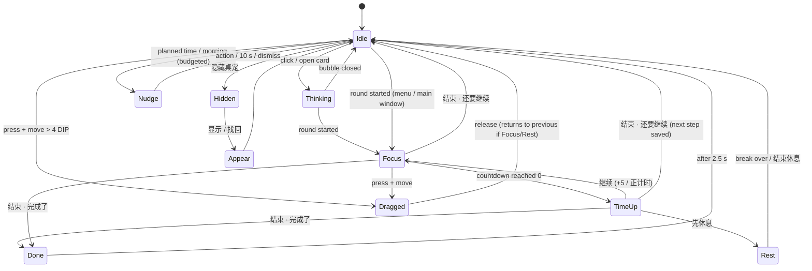

# T计划桌宠 — Design Proposal (v1)

> **Integration update (2026-11-02):** Codex now implements the complete pet on Claude's shared runtime; Claude owns the full platform. Nine production sprites and a Windows portable build exist. See [integration handoff](integration-handoff.md) and [verification](verification/README.md) for current scope and evidence.

> **Status update (2026-11-02):** the division of work changed. Character art (standing image, expressions, motion assets) is now supplied by the project owner through a separate design assistant.
> - §2 (character appearance) and §8 (art asset list / layer plan / illustrator brief) are **superseded**. The program-side contract is now [`character-pack-spec.md`](character-pack-spec.md): one transparent PNG per state, with fallback to idle.
> - A first implementation exists in [`desktop/`](../../desktop/README.md). That README states which parts are verified, which still need Windows hands-on testing, and which are not built yet.
> - Everything else below remains the design reference. Where it differs from the implementation, the README describes actual behaviour.

Inputs reviewed for this proposal:

| Input | What it is | How it is used |
|---|---|---|
| `T计划 v4.0.html` (single-file web app, ~234 KB) | The existing T计划 main app: today view, timer, review, week plan, decision tree, schedule, optional online AI | Source of the data model (`tplan.v3`), timer semantics, review logic and visual tokens. The pet is designed to plug into this, not replace it. |
| Image 1 — "T计划 · 桌宠角色设定" sheet | Main pose, side/back views, 6 expressions (平静 / 专注 / 思考 / 提醒 / 开心 / 休息), 2 scene poses (安静陪读 / 完成一小步) | **Primary visual reference** (costume, palette, expression set). |
| Image 2 — "Claude娘" sheet | Detail crops (eye, hair ornament, collar, sleeve, hem, book), 12 expressions, palette with hex values | Secondary reference for details and palette values. |
| Image 3 — "Claude · 优雅的大小姐" illustration | Desk scene, 高冷 / 傲娇 / 日常 panels | Reference for the "a little proud" personality and expression range only. |

**Gap to flag:** the request mentions a *latest standing-idle image (直立待机图)* as the default-pose reference. I only received the three images above. None of them shows the required pose exactly: Image 1's 主形象 is mid-step with one arm extended. This design therefore specifies the standing-idle pose in writing (§2.3). Please send the standing-idle image before art production starts. It should replace §2.3 wherever the two disagree.

**Rights note:** Images 2 and 3 carry social-media hashtags and look like third-party fan art. Using them as private style references is fine. The shipped sprite should be newly drawn (or commissioned) from the written spec plus Image 1, not cut out of Images 2 or 3.

---

## 1. Positioning

**What she is:** a small, quiet front-end to T计划's *execution loop*. She is not a second planner and not a virtual pet to look after.

T计划 already has the planning side: tasks, week plan, decision trees, schedule and review. The weak link you described is the stretch **between "I have a plan" and "I actually did a bit of it, and I know where to resume."** The pet sits on the desktop to cover exactly that stretch:

```
 many wishes ──► ONE thing now ──► start small ──► quiet focus ──► auto record ──► next step saved
   (清单)          (今天先做什么)     (先做 5 分钟)     (陪读)          (自动记账)        (下次从这里继续)
```

Design principles that follow from your description:

1. **One thing at a time.** By default she only ever shows *one* current task.
2. **Starting is cheaper than planning.** One click starts a 5- or 10-minute round, with no category, estimate or reflection required.
3. **Silence is the default during focus.** The only interruption she makes during a round is when its time is up.
4. **Records are a by-product, not homework.** Ending a round *is* saving it. Notes are optional and can be added later.
5. **She speaks from evidence.** Every judgement she voices comes from timer sessions, check-offs or notes. "No record" is never presented as "didn't study".
6. **No maintenance burden.** No feeding, no check-ins, no affection points, and no punishment for unfinished tasks.
7. **You keep the decisions.** She and the optional AI can propose. Only you reschedule, change or delete.

**Assumption I am making:** the main failure point is *starting* and *resuming*, not lack of planning tools. If the real bottleneck turns out to be over-planning (too many tasks dated "today"), the "today" selector (§3, F1) is where to push harder. One option would be capping "today" at 3 tasks. I have **not** made that a hard rule in v1.

---

## 2. Character

### 2.1 Fixed traits (keep across every asset)

| Element | Spec |
|---|---|
| Proportion | Chibi / Q-version, about **2.5–2.8 heads tall**. The head is about 36% of the total height so the face stays readable at 200 px. |
| Hair | Very long copper-orange hair, falling to the knees or calves, with soft waves and an ahoge. Two-tone: a base colour and one shadow tone. At small sizes, group the strands into large shapes. |
| Eyes | Amber with a single bright catchlight. Use large eyes; they carry most of the expression. |
| Hair ornament | An orange chrysanthemum/marigold flower on the right side of the head, with a black bow and two cream-white ribbon tails. |
| Outfit | A cream-white blouse with a frilled collar and a short capelet, and puffed sleeves with ruffled cuffs. The skirt is deep brown-black with a terracotta front panel or sash, over cream ruffled petticoat layers. Cream lace-up ankle boots. |
| Prop | A deep-brown study journal held against the chest with both hands, with a gold-ish **"T"** on the cover. |
| Mood | Warm, elegant, patient, and a *little* proud. |

**Palette.** Hex values are taken from the Image 2 swatches and cross-checked against the T计划 CSS tokens:

| Role | Hex | Notes |
|---|---|---|
| Hair base | `#D86B3F` | T计划 `--accent` is `#D97757`, so the two harmonise |
| Hair light | `#F3B089` | |
| Skin / warm cream | `#FCE7D9` | |
| Cloth cream (must stay **opaque**) | `#FFF9F4` | |
| Ink brown-black (skirt, bow, lines) | `#3B2F26` | |
| Muted shadow on cream | `#E0C9BB` | |
| Terracotta / bronze | `#B8733C` | |
| Gold accent (sparingly) | `#F0D4A5` → line gold `#C9A15A` | |
| UI accent (bubbles, buttons) | `#BF5D39` | Same as T计划 `--btn`, so the pet UI and the main app match |

### 2.2 Simplifications for desktop size (default height 260 px)

At 260 px the face is roughly 95 px wide. Anything thinner than about 1.5 px at display size turns into noise.

- **Remove:** chains, small pendants, earring dangles, tassel strings (keep at most one tassel as a solid shape), and lace patterns on cuffs (draw them as a scalloped outline).
- **Reduce:** skirt embroidery to **3–4 large gold flower motifs** on the hem band. Draw no embroidery on the capelet; keep one flower brooch at the collar.
- **Keep, and draw slightly oversized:** the hair flower (about 22% of head width), the black bow, the "T" on the book (at least 12 px tall at default size), the eyes and the ahoge.
- **Lines:** a warm dark-brown outline (`#4A3326`), not black. Draw it about 2 px at the 260 px export (about 8 px on the 4× master), with thinner interior lines.
- **Shading:** two tones (base + shadow), plus one highlight on the hair and eyes. Avoid soft airbrush gradients on the edges, because they create halo artefacts on transparency.

### 2.3 Default standing-idle pose (written spec, pending your image)

- Front-facing, or a very slight 3/4 view (no more than 10°). The head is upright and the body is square to the viewer.
- Shoulders are level. Both feet are flat on **one shared baseline**, slightly apart, toes slightly out.
- Both hands hold the journal at the chest, with the book cover facing the viewer so the "T" reads.
- The weight is centred, and the hair and skirt hang straight down and are symmetric overall.
- **Not allowed for idle:** leaning on a wall, hip-shot or contrapposto, crossed legs, standing on one foot, a raised arm, or a walking stride. (Image 1's 主形象 stride is a *non-default* pose.)

### 2.4 Personality and voice

**She is** a gentle, rational and patient study partner with a small streak of pride.

**Where the 小傲娇 shows:**

- A slight chin-up and closed-eye smile on completion. A rare, light self-compliment ("我挑的这一步，果然刚刚好。").
- Lines are short and composed. She never scolds, sulks, cries or guilt-trips.

**What she never does:**

- Comment on unfinished work as a failure.
- Infer reasons ("你是不是又分心了").
- Claim you didn't study when there is simply no record.
- Ask you to take care of her.

**Line bank.** All lines are short (≤ 24 characters where possible), each pool rotates without repeating within a day, and every line can be dismissed:

| Moment | Lines (rotate) |
|---|---|
| Before start | 先看一题就好，我把书签替你夹好了。 / 就五分钟，开个头。 / 书已经翻到这一页了。 |
| Too many plans | 想做的都收好了。今天先推进这一件吧。 / 清单不会跑，先挑一件。 |
| Shrinking a task | 这件有点大。第一步是什么？ / 缩到“打开就能做”的大小吧。 |
| Time up | 这段时间记下来了。继续一会儿，还是先休息？ |
| Completed | 这一小步，拿下了。 / 嗯，和我预想的一样顺利。 / 哼，本小姐挑的这一步，刚刚好吧。 *(rare, ≤1/day)* |
| Not finished | 先留在这里，下次接着这一页。 / 书签夹好了，下次从这里开始。 |
| Review | 记录已经整理好了，想到什么再补一句。 |
| Resume next time | 上次停在：「{next}」。从这里继续？ |
| After sleep / restart | 刚才电脑睡着了，计时停在 {mm:ss}。接着来吗？ |
| Rest | 休息一下，我帮你看着时间。 / 休息好了？书签还在原处。 |
| Planned time | {at} 的「{task}」到时间了，现在开始吗？ |

---

## 3. Scope: v1 vs. later

### v1 (must ship)

| # | Feature | Notes |
|---|---|---|
| D1 | Separate transparent, frameless pet window | §7 |
| D2 | Two launch modes (with the main window / pet only) and three distinct exits (close main window / hide pet / quit app) | §4.7 |
| D3 | Drag to move, with click/drag distinction and position+size persistence | §4.4 |
| D4 | Click-through on transparent areas; lock-position mode; full click-through mode, recoverable from the tray | §4.5 |
| D5 | Always-on-top toggle, multi-monitor and DPI handling, clamp to the screen, auto-recovery, find-pet, manual quiet mode | §4.6 |
| D6 | Tray menu with every required item, plus opt-in launch at login | §4.8 |
| F1 | "今天先做什么": separate *later list* vs *today*, one highlighted current task, quick switch | §4.2 |
| F2 | Easy start: 先做 5 / 10 分钟, start without metadata, "shrink to a first step" | §4.2 |
| F3 | Focus timer: countdown and count-up, pause/resume/end, mini timer chip, one shared timer, sleep/restart rules | §7.6 |
| F4 | Auto record on end: one-tap outcome, optional one-line note, exactly-once save | §7.7 |
| F5 | Short "today" review from records, keeping the next step, distinguishing "not done" from "no record" | §4.3 |
| F6 | Two-way sync with T计划 and deep links to its pages; works with the main window closed | §7.5 |
| — | Character states from §5 using expression swaps plus small procedural motion (blink, breath, hair sway) | §5, §9 |
| — | Offline operation for everything above | |

### Later (v1.1+)

- Automatic quiet mode when a fullscreen app or presentation is detected (Win32 `SHQueryUserNotificationState`, via FFI).
- AI in the pet: "帮我拆一下" first-step suggestions and an evening summary draft. v1 keeps AI in the main app only, where it already exists.
- Optional global hotkey (e.g. start or pause the timer).
- Walking, sitting and reading-at-desk poses, and idle wandering along the taskbar (off by default even then).
- Week review on the pet, and a streak-free "this week's footprints" view.
- Moving the vault folder sync (currently the browser File System Access API) into the main process.
- Seasonal outfits, a Live2D or Spine rig, and voice or sound packs.

**Explicitly out of scope:** affection meters, feeding, daily login rewards, sad or angry reactions to unfinished tasks, and automatic rescheduling or deletion.

---

## 4. Interaction design

### 4.1 Desktop resting state

- Only the character is visible. There is no frame, no shadow box and no taskbar button.
- **When a timer is running**, a small **timer chip** sits beside her skirt on the side away from the screen edge, for example `● 18:42`. Its states:
  - **running:** terracotta dot.
  - **paused:** hollow dot plus `已暂停`.
  - **due:** a softly pulsing dot plus `时间到`.

  Clicking the chip toggles a 3-button mini control. Right-click → 计时小条 → 收起 shrinks the chip to a dot.
- **Hover:** after a 700 ms dwell, a faint tag with the current task title appears under the feet. It is suppressed while a round is running.
- She never moves on her own in v1. Her position changes only when you drag her.

### 4.2 Single click → main card (the "one thing" card)

A single click on the character opens **one** bubble. There is only ever one bubble at a time.

**A. No current task yet:**

```
┌──────────────────────────────────────┐
│ 想做的都收好了。今天先推进这一件吧。     │
│  ○ 实验报告的抄写        14:00 · 30′  │  ← up to 3 candidates:
│  ○ 考研数学 极限 20 题    09:30 · 60′  │    pinned → overdue → today by time
│  ○ 传感器 应变片原理      19:00 · 90′  │
│  从清单里挑…    直接说一件事…            │
└──────────────────────────────────────┘
```

Picking a candidate sets `S.main[today]`, the existing "今日主任务" field, and turns the bubble into card B.

**B. Current task set, no timer running:**

```
┌──────────────────────────────────────┐
│ 考研数学 极限 20 题                     │
│ 下一步：从第 13 题开始（夹逼）           │  ← the saved `next` step, if any
│ [▶ 先做 5 分钟] [▶ 10 分钟] [▶ 按计划 60′] │
│  缩小一点   换一件   ⋯                   │
└──────────────────────────────────────┘
```

- **▶ buttons** start a round immediately. Nothing else is required.
- **缩小一点** (shrink) opens an inline field: `第一步是… [_____]`. It offers three canned chips: `先看第一道例题`, `先读 2 页`, `先打开文件写个标题`. A previously saved `next` step is pre-filled. The step is stored on the round as `step`, and on the task as `next` if it is still open at the end of the round. AI suggestions for this are a v1.1 item.
- **换一件** goes back to list A. **⋯** shows `打开这个任务` (deep link), `明天再做`, `放回清单`, and `今天不设主任务`.
- **"从清单里挑…"** opens a scrollable list of up to 8 items from the *later* list and today's other tasks.
- **"直接说一件事…"** is a one-line input that reuses T计划's existing `tParse` ("传感器第三章 50分钟", "正计时 背单词").

**C. Timer running:** a click opens the mini control only, with `暂停 / 结束 / +5′` and the task and step text. There is no chatter.

**Dismissal:** click outside, press Esc, or click the character again. Information-only bubbles auto-hide after 8 s. Bubbles with actions stay until you act; after 30 s they collapse to a small dot on her shoulder, which brings them back when clicked. This is the **"稍后处理"** behaviour.

### 4.3 Review bubble ("今天")

Open it from right-click → 今天回看, or from the "今天" link at the bottom of card B:

```
┌─────────────────────────────────────────────┐
│ 今天记录了 3 段，共 1 小时 45 分。              │
│ ✓ 实验报告的抄写            18′  完成           │
│ ◐ 考研数学 极限 20 题        45′  还要继续        │
│     下一步：从第 13 题开始                       │
│ · 传感器 应变片原理          —   今天没有计时记录   │
│     [明天再做] [放回清单] [今天还做]               │
│ 记录已经整理好了，想到什么再补一句。  [打开回看页] │
└─────────────────────────────────────────────┘
```

The rules are evidence-driven:

| Data | Shown as | Never shown as |
|---|---|---|
| Task done + sessions | `✓ 完成` + minutes | |
| Task not done + sessions | `◐ 还要继续` + minutes + `next` | "没完成" |
| Task done, no sessions | `✓ 已勾选完成（没有计时）` | |
| Task dated today, not done, no sessions | `今天没有计时记录` + three decision buttons | "没做", "拖延" |
| Sessions with no task | Grouped as `其他记录` | |

- The three decision buttons are the only way a task changes date. Nothing is rescheduled automatically.
- No reasons are guessed. Reflections appear only if you wrote them, either through the existing keyword-based reflection capture or by adding a note.
- The proactive evening prompt ("今天的记录整理好了，要看一眼吗？") is **off by default**. When you enable it, it fires once a day at a time you choose.

### 4.4 Drag

- Press on a **visible pixel** of the character and move it more than **4 DIP**, or hold it for 300 ms and move: that is a drag. Anything less is a click.
- During the drag she switches to the *being-dragged* state (§5), and bubbles and menus close.
- On release she lands with a 120 ms settle (§5). **No click, bubble or timer action fires on release.** A drag also suppresses the click that would otherwise follow it.
- The position is clamped (§4.6) and saved 500 ms after release.
- Interactive controls (bubble buttons, the timer chip, inputs) are never drag handles.
- When **锁定位置** (lock position) is on, pressing and moving does nothing, and click still works.

### 4.5 Click-through

| Mode | Character pixels | Transparent area | Bubble / chip | Exit |
|---|---|---|---|---|
| **Normal** (default) | Clickable, draggable | Passes clicks to the windows below | Clickable | — |
| **锁定位置** (lock position) | Clickable, not draggable | Passes clicks | Clickable | Context menu or tray |
| **全部穿透** (full click-through) | Passes clicks; character drawn at 70% opacity as a cue | Passes clicks | Hidden | **Tray: 恢复桌宠交互**, or tray left-click |

The first time full click-through is enabled, a one-time bubble explains how to get out of it: "要恢复操作，请到右下角托盘图标里点「恢复桌宠交互」。"

### 4.6 Topmost, screens and quiet mode

- **始终置顶** (always on top): on by default, at Electron's default `floating` level, which on Windows sits **below the taskbar**. Stay at that level: higher levels would cover the taskbar and fullscreen apps.
- **Focus:** the pet window is created non-focusable and is shown with `showInactive()`, so it never steals keyboard focus. It only becomes focusable while a bubble's text input is active (§7.3).
- **Clamping:** at least **60% of the character's visible box** must stay inside some display's *work area* (the screen minus the taskbar). The transparent margin of the window may go off-screen. Bubbles flip to the side with more room, and above or below if needed.
- **Recovery:** this runs on display-removed, display-metrics-changed (resolution or DPI change), and at every startup. If the clamp rule fails, she moves to the **bottom-right of the primary display's work area**, 24 DIP from the edges.
- **一键找回** (find pet, from the tray or the main window menu): does the same recovery move, plus `show`, plus a short reappear animation.
- **安静模式** (quiet mode), toggled manually from the tray or context menu:
  - Proactive bubbles are fully muted, and the time-up alert becomes a chip pulse only.
  - The character switches to the 安静陪读 (quiet reading) expression.
  - Optionally she can be set to hide entirely while quiet mode is on.
  - Automatic fullscreen detection is a v1.1 item.

### 4.7 The three "close" actions

| Action | Where | Effect | Background keeps running? |
|---|---|---|---|
| **Close T计划 main window** (× on the main window) | Main window | The window is destroyed. Pet, tray, timer and saving continue. The first time, a toast explains: 「T计划还在托盘里，计时和桌宠不受影响」 | **Yes** |
| **隐藏桌宠** (hide pet) | Context menu, tray, or main window | The pet window hides. The timer continues. Due alerts fall back to a Windows toast notification and the tray tooltip. | **Yes** |
| **退出 T计划** (quit) | **Tray menu only** (also in the main window's menu) | Saves state; if a timer is running, auto-pauses it at quit time (§7.6); then the process ends. | No |

**Launch modes:**

- `T计划` shortcut: opens the main window plus the pet, if the pet was visible last time.
- `T计划 桌宠` shortcut (`--pet-only`): pet plus tray only; the main window is not created.
- Launch at login (opt-in) uses `--pet-only --autostart`.
- A second launch while the app is running does not start a second process. It forwards its arguments to the running instance (for example, opening the main window).

### 4.8 Tray

| Mouse | Action |
|---|---|
| Left click | Show the pet. If full click-through is on, restore interaction. |
| Double click | Open T计划 |
| Hover | Tooltip, for example `T计划 · 专注中 18:42 · 考研数学 极限 20 题` |
| Right click | Menu below |

```
打开 T计划
───────────
✓ 显示桌宠              (toggle)
✓ 始终置顶              (toggle)
  安静模式              (toggle)
  恢复桌宠交互           (enabled only when locked / full click-through)
  找回桌宠位置
  大小  ▸  小 200 / 默认 260 / 大 320 / 自定义…
───────────
  计时：暂停 / 结束      (only while a timer is active)
───────────
  开机自动启动（只启动桌宠） (toggle, default OFF)
  退出 T计划
```

The tray icon has a small dot overlay while a timer is running, and an accent dot when the timer is due.

### 4.9 Right-click on the character

The right-click menu is a native menu (`Menu.popup`), which is keyboard accessible, never clipped, and does not need the pet window to grow.

```
今天先做什么…
今天回看
打开 T计划 ▸   今天 / 当前任务 / 本周 / 回看
───────────
安静模式
锁定位置
全部鼠标穿透
大小 ▸
计时小条 ▸   展开 / 收起
───────────
隐藏桌宠
```

"退出" is deliberately not in this menu, so that you cannot quit while trying to hide her. It stays in the tray.

### 4.10 Proactive speech budget (anti-interruption rules)

| Rule | Value |
|---|---|
| Proactive bubbles during a running round | **0**. Only time-up. |
| Max proactive bubbles per day (excluding time-up and responses to your clicks) | 4 |
| "今天先推进哪一件？" morning nudge | At most once a day, only if no main task is set, only on her first appearance that day |
| Planned-time nudge (task has `at`) | Once per task, only if no timer is running, auto-collapses after 10 s, can be turned off |
| Bubbles while you are typing in another app | Delayed until 5 s of mouse/keyboard idle, measured with `powerMonitor.getSystemIdleTime()` (granularity is seconds) |
| Quiet mode | Everything muted except time-up, which becomes a chip pulse |

---

## 5. Character states

The default is **直立待机 (standing idle)**. Every other state is entered by a single trigger and has a single way back to idle. Her feet baseline is fixed in every state; only the upper body, head, hair and ribbons move.



| State | Trigger | Expression and motion | Line / buttons | Duration | Back to idle | Anti-interruption |
|---|---|---|---|---|---|---|
| **直立待机** Idle | Default | Neutral soft smile (平静). Blink every 3–6 s, randomised, closing over 3 frames in about 150 ms. Breath: upper body translateY 0→1 px on a 4 s sine. Ribbons and hair tips rotate ±1.5° on a 6 s cycle. **Feet locked.** | None | Indefinite | — | No motion larger than 1–2 px, no drift |
| **被拖拽** Dragged | Press + move > 4 DIP | Small surprised "o" mouth, round eyes. The whole sprite tilts −3° pivoting at the head, and hair and ribbons lag by about 80 ms. | None | While dragging | On release: 120 ms settle (translateY +2 → 0), then the previous state | Bubbles close; nothing fires on release |
| **思考 / 查看任务** Thinking | Click opens a card, or card B is shown | Eyes look up and to the side, with three small "…" dots above her head that fade in | Card A/B/C (§4.2) | While the card is open | Card closes → idle | Only triggered by you |
| **安静陪读** Focus | A round is running (from any window) | Eyes lowered to the open journal (Image 1's 专注). The book opens using a hands-and-book variant. Blinks are slower (every 5–9 s) and breathing is unchanged. | Timer chip only | The whole round | Round ends → Done or Idle | **Zero proactive bubbles.** No sound. |
| **轻声提醒** Nudge | Planned-time / morning nudge (budgeted), or resume after sleep/restart | Looks at the viewer with a gentle smile and a small hand raise holding the book (Image 1's 提醒) | One line plus 1–3 buttons (`现在开始` / `稍后` / `×`) | 10 s, then collapses to the shoulder dot | Action, dismiss, or timeout | Budget §4.10; never while a timer runs |
| **计时结束** TimeUp | Countdown reaches 0 | Looks up at the viewer, eyes slightly widened, with a tiny bookmark-shaped sparkle | 「这段时间记下来了。继续一会儿，还是先休息？」<br>`[再 5 分钟] [正计时继续]`<br>`[✓ 完成了] [还要继续] [先休息]` | Until answered; after 30 s it collapses to the dot and the chip pulses. **Auto-finalised** after 15 min (§7.7). | Any choice → the matching state | One soft chime (can be disabled). Windows toast only if the pet is hidden. |
| **完成一小步** Done | A round ends with 完成了, or the task is checked off anywhere | Closed-eye smile, chin raised 2°, two small sparkles (Image 1's 完成一小步). The rare 傲娇 line variant is used here. | 「这一小步，拿下了。」 plus a 10 s `撤销` link | 2.5 s | Auto | Shown once per completion |
| **休息** Rest | 先休息 after time-up, or menu → 休息 5 分钟 | Eyes closed and relaxed, a slow "z" floating up (Image 1's 休息). The journal is closed. | Chip shows `休息 4:12`. At the end: 「休息好了？书签还在原处。」 `[继续这一页] [今天先到这]` | 5 min by default (3/5/10 selectable). **Not recorded as study time.** | Break ends → nudge line → idle | One line at the end, nothing during |
| **隐藏** Hidden | 隐藏桌宠 / quiet mode with hide | 180 ms fade plus scale 1 → 0.96 from the feet | None | — | — | The timer continues; alerts go to a toast and the tray |
| **重新出现** Appear | Show, find, or app start | 220 ms fade-in plus scale 0.96 → 1, with 3–4 small petals falling (optional) | None. Exception: on the first appearance of the day with no main task, the morning nudge (budgeted). | 220 ms | Auto → Idle (or Focus if a round is active) | Petal effect disabled in quiet mode |

Lines that react to your actions (Done, "not finished") appear **only when the action happened in the pet**. If you end a round from the main window, the pet just switches expression and does not also talk; the main window already showed the confirmation.

---

## 6. End-to-end walkthrough

**① Start the pet only.** Start Menu → **T计划 桌宠** runs `TPlan.exe --pet-only`.

- The core process starts, loads `state.json`, and creates the tray icon and the pet window. No main window is created.
- She *appears* at the last saved position, which is clamped if the monitor layout changed.
- No main task is set today, so the budgeted morning nudge shows once: 「今天先推进哪一件？」.

**② Pick the current task.** Click her: she switches to *Thinking* and card A lists three candidates. You pick `考研数学 极限 20 题`.

- The core sets `S.main["2026-11-02"]`.
- Yesterday's round left a next step on this task, so card B shows 「下一步：从第 13 题开始（夹逼）」.

**③ Start.** Click **▶ 先做 10 分钟**.

- The core creates `S.active` (`mode:'down'`, `budget:600000`, `step:'从第 13 题开始（夹逼）'`) and broadcasts it.
- She switches to *Focus* (eyes on the book), the bubble closes, and the timer chip shows `● 09:59`.
- If the main window were open, its 计时 page would show the same countdown, because it renders the same `S.active`.

**④ Focus.** You work. Nothing pops up. You drag her out of the way once: she plays the dragged state, then lands and returns to *Focus*.

**⑤ Time up.** At 0:00 the core switches the phase to `due`.

- It **writes the session immediately** (10 min, `outcome:null`) and marks the alert as sent.
- One soft chime plays and she enters *TimeUp*: 「这段时间记下来了。继续一会儿，还是先休息？」.
- You click **正计时继续**. The same session record keeps growing, and the chip shows `● +00:00 ↑`.

**⑥ End and auto-record.** Twenty minutes later you click the chip, then **结束**.

- The session is updated to 30 min, with `end` set.
- The bubble asks 「这一步怎么样？」 with `[✓ 完成了] [还要继续]`, plus an optional one-line field `说一句（可不写）`.
- You type 「卡在第 17 题」 and click **还要继续**. If you ignore the bubble instead, the record is already saved with outcome 待定, and the bubble collapses.

**⑦ Keep the next step.** Because the outcome is *continue*, the bubble offers a next-step field pre-filled from your note: 「下一步：从第 17 题开始」. Press Enter, or leave the suggestion as is.

- The core saves `task.next`.
- She says 「先留在这里，下次接着这一页。」 and returns to *Idle*.
- The note containing 卡 is also stored as a reflection, by the existing T计划 rule.

**⑧ Reopen T计划.** Right-click → 打开 T计划 ▸ 回看. The main window opens directly on the review page, reading the same in-memory state from the core. It shows:

- the 30-minute session with your note;
- the task as `◐ 还要继续 · 下一步：从第 17 题开始`;
- today's other dated tasks marked `今天没有计时记录`, with the three decision buttons.

You change the date of one task in the main window. The pet's card A updates the next time it opens, because the change was broadcast with the next state revision.

---

## 7. Windows technical design

### 7.1 Electron vs. Tauri

API facts below were checked against the **current official docs sources** on 2026-11-02: the `electron/electron` `main/docs`, with Electron latest at `45.2.1`, and `tauri-apps/tauri` `packages/api/src/window.ts`, with `@tauri-apps/api` latest at `2.12.4`. The docs websites were not reachable from my environment, so I read the same docs from their GitHub sources.

| Requirement | Electron | Tauri v2 |
|---|---|---|
| Transparent frameless window | `transparent:true` + `frame:false`. On Windows, transparency requires frameless. Docs list the limits: no click-through on transparent areas by itself, not resizable, and DevTools breaks transparency. | `transparent: true` in the window config (WebView2 on Windows) |
| **Click-through on transparent pixels, clickable character** | `win.setIgnoreMouseEvents(true, { forward: true })`: `forward` is supported on **Windows** and macOS. Mouse *moves* still reach the page, so it can hit-test and toggle. This is the standard desktop-pet pattern. | `setIgnoreCursorEvents(ignore)` has **no forward option**. While ignoring, the page receives nothing, so it has to **poll** `cursorPosition()` (physical px) at roughly 30–60 Hz from JS or Rust and hit-test itself. This works, but adds latency and code. |
| Drag | Custom drag: renderer pointer events plus main-process `setPosition`, using `screen.getCursorScreenPoint()` | `startDragging()` hands the drag to the OS (smooth), but the page then doesn't see the pointer up. Click vs. drag must be decided before calling it. |
| No focus stealing | `focusable:false` (on Windows it also implies `skipTaskbar`), `showInactive()`, and `setFocusable()` at runtime | `setFocusable`, `focus:false` in config |
| Tray | `Tray` + `Menu`, mature | `TrayIcon` (core), fine |
| Single instance plus forwarding arguments | `app.requestSingleInstanceLock()` plus a `second-instance` event with `argv` | `tauri-plugin-single-instance` |
| Launch at login | `app.setLoginItemSettings({openAtLogin, args})` (Windows supports `args`) | `tauri-plugin-autostart` |
| Sleep / lock / shutdown hooks | `powerMonitor` `suspend`/`resume`, `lock-screen`/`unlock-screen` (Windows), `getSystemIdleTime()`. On Windows, shutdown and log-off arrive as the BrowserWindow events `query-session-end` / `session-end` (powerMonitor `shutdown` is Linux/macOS only). | Needs Rust and Win32 code, or plugins |
| Multi-monitor and DPI | `screen` events `display-added`/`removed`/`metrics-changed`, `getDisplayMatching`, DIP↔physical helpers on Windows | `availableMonitors`, `monitorFromPoint`, physical/logical positions |
| Notifications | `Notification` (Windows toast; needs an AppUserModelID, which the installer sets) | `tauri-plugin-notification` |
| Secret storage (AI key) | `safeStorage` uses DPAPI on Windows | Plugin or keyring crate |
| Language for app logic | All JS; the existing T计划 HTML/JS runs unchanged in the renderer | JS front end plus **Rust** for anything native |
| Footprint | Larger. Installer is roughly 80–110 MB; RAM roughly 150–250 MB with two renderers. *These are typical figures, not measured for this app.* | Much smaller. Installer is a few MB, and it uses the system WebView2. |

**Recommendation: Electron for v1.**

- The hardest requirement is per-pixel click-through with a clickable character. Electron supports it natively on Windows (`forward:true`); Tauri needs a polling workaround.
- The existing 234 KB T计划 app is plain JS with no build step and can be loaded nearly as-is.
- Sleep, session-end, tray, single-instance and login-item behaviour are all first-party and documented.
- The cost is disk and RAM. That is acceptable for a personal tool, but revisit it if you later want to distribute widely. The core and store are framework-agnostic JS, so a later Tauri port would mainly mean rewriting the window and tray layer.

### 7.2 Process and window architecture

```
┌──────────────────────── Electron main process = "Core" ────────────────────────┐
│ Store (single writer)  · state.json (same shape as tplan.v3 `S`) · revision rev   │
│ TimerEngine            · S.active transitions · due scheduler · heartbeat          │
│ Reminder scheduler     · speech budget · planned-time nudges                       │
│ Persistence            · atomic writes · daily backups                             │
│ Platform               · Tray · powerMonitor · screen · single-instance · login   │
│ AI proxy (optional)    · moves provider calls + key out of the renderer           │
└───────────────▲───────────────────────────────────────────▲───────────────────────┘
       IPC (preload, contextIsolation)                 IPC
┌───────────────┴───────────────┐                ┌──────────┴───────────────┐
│ Main window (optional)         │                │ Pet window (always exists)│
│ existing T计划 HTML, adapted:  │                │ sprite + bubble + chip    │
│  load()/save() → core          │                │ renders PetView from core │
│  timer & wrap → core commands  │                │ sends commands only       │
└────────────────────────────────┘                └──────────────────────────┘
```

- **The core owns all state and all timing.** Renderers never mutate shared state directly. They send *commands* and render *snapshots*.
- **Closing the main window destroys its renderer.** That frees memory and loses nothing, because the state lives in the core.
- The pet window is created at startup and hidden or shown. It is never destroyed while the app runs.
- **Security:** `contextIsolation:true`, `sandbox:true`, `nodeIntegration:false`, a strict CSP, and no remote content.
  - The Google Fonts `<link>` in the current HTML is replaced by a bundled Noto Serif SC subset or system-font fallbacks, so the app works offline.
  - The current HTML calls AI providers straight from the page, with the key in `localStorage` and the Anthropic header `anthropic-dangerous-direct-browser-access`. In the desktop app those calls move to the core, with the key encrypted via `safeStorage`.

### 7.3 Pet window

```js
// main: create once
pet = new BrowserWindow({
  width, height,                    // fixed per scale (see below), in DIP
  transparent: true, frame: false, resizable: false,
  hasShadow: false, skipTaskbar: true, focusable: false,
  alwaysOnTop: settings.alwaysOnTop, show: false,
  backgroundColor: '#00000000',
  webPreferences: { preload, contextIsolation: true, sandbox: true },
});
pet.setIgnoreMouseEvents(true, { forward: true });   // start click-through
pet.showInactive();                                  // never steal focus
```

- **Size:** the window has a fixed size for each scale, so transparent windows are never resized during animation. For a character of height H (default 260 DIP), the window is about `2.0·H × 1.55·H` (≈ 520 × 400 at default). The character is anchored at the **bottom centre**, and the extra transparent space holds bubbles. Changing the size preset sets new bounds once.
- **Hit-testing:** the renderer runs this loop on `mousemove`, which keeps arriving thanks to `forward`:
  1. `elementFromPoint`: if the element is a bubble, chip or menu control (`[data-hit]`), it is a **hit**.
  2. Otherwise, sample the current sprite's **alpha hit mask**: a 1/4-resolution `Uint8Array` precomputed per expression, dilated by 3 px so thin hair tips are still grabbable. If alpha > 40, it is a hit.
  3. When the hit state changes, `ipc 'pet:hit'` → `pet.setIgnoreMouseEvents(!hit, { forward: true })`. Changes are throttled to edges only, so there is no IPC on every mousemove.
  4. In **full click-through** mode the renderer ignores hits. Only the tray can call `setIgnoreMouseEvents(false)` again.
- **Text input:** when you focus a bubble's input, the core calls `pet.setFocusable(true); pet.focus()`. On blur or close it calls `setFocusable(false)`.

### 7.4 Drag implementation

1. On `pointerdown` over a hit pixel, the renderer calls `setPointerCapture` and records the start point. It sends no IPC yet.
2. Once movement passes 4 DIP, the renderer sends `pet:drag-start`. The core stores `offset = cursorScreenPoint − windowPos`, then starts a 60 Hz loop: `pos = screen.getCursorScreenPoint() − offset` → `pet.setPosition(pos)`.
   - Computing the position in the core, in DIP, avoids renderer coordinate errors when crossing monitors with different scaling.
3. On `pointerup` (or `lostpointercapture` as a fallback), the renderer sends `pet:drag-end`. The core stops the loop and **re-asserts the window size** with `setBounds`, which guards against size drift after crossing mixed-DPI monitors. It then applies the clamp (§4.6) and saves `{displayId, x, y, scale}` to `pet-window.json`.
4. Click is only dispatched on `pointerup` **if** no drag started.

### 7.5 Data, sync and IPC

**Storage**, in `app.getPath('userData')` (`%APPDATA%\T计划\`):

| File | Content |
|---|---|
| `state.json` | The same structure as today's `tplan.v3` (`tasks, main, sessions, notes, trees, active, settings…`) plus the new fields below |
| `state.json.bak-YYYYMMDD` | Last 7 daily backups |
| `pet-window.json` | Per-device window state: position, display, scale, topmost, lock, click-through, quiet, launch prefs. **Kept out of `state.json`** so it never syncs across devices through the vault. |
| `secrets.bin` | AI key, encrypted with `safeStorage` |

**Writes:**

- Every write is **atomic**: write `state.json.tmp`, flush, then rename over the original.
- Timer transitions and session writes are persisted **immediately**. Other edits are debounced by 300 ms.
- The app flushes on quit and on `session-end`.

**Schema additions** (backwards-compatible through the existing `normalize()`):

```ts
task.date      : string | null      // null = "以后想做" (later list); today = selected for today
task.next      : string | null      // "下一步从哪里继续"
task.nextAt    : number | null
session.outcome: 'done' | 'continue' | null   // null = 待定 (record exists, outcome not chosen)
session.step   : string | null      // the shrunk first step used for this round
session.src    : 'timer' | 'pet' | 'manual'
active.step, active.beat (heartbeat ms), active.dueNotified (bool),
active.autoPaused: null | 'sleep' | 'quit' | 'crash' | 'lock'
active.sessionWritten (bool)
```

**Command protocol:**

- **Renderer → core:** `dispatch({type, payload, expect})`. `expect` carries preconditions, for example `{activeId, phase}` for timer commands.
- The core processes commands **one at a time** in a single queue. A stale command, such as a second "end" for an already-ended round, is rejected as a no-op, and the sender receives the current state.
- **Core → renderers:** `state:changed {rev, changedKeys}`.
  - The main window pulls the slices it needs.
  - The pet receives a small computed `PetView`: current task, `next`, active timer, today summary and pending bubble.

**Migration:** the existing data lives in the browser's `localStorage` for the HTML file's origin, which the desktop app cannot read. First run therefore offers **导入**, using the JSON the current version already exports (the existing import box), or starting fresh. Nothing is migrated silently.

**Changes to the existing HTML:**

- `load()` / `save()` become `core.get()` / `core.dispatch('replace-slice' | specific commands)`.
- `beginTimer`, `tctl` and `wrapSave` become core commands, and `setInterval(tick, 500)` stays for display only.
- The document Picture-in-Picture timer (`pip`) is redundant next to the pet and can be hidden in the desktop build.
- The vault folder sync uses `showDirectoryPicker`. Keep it as-is for v1 if it works in Electron's Chromium; otherwise disable it in the desktop build until v1.1 moves it into the core.

### 7.6 Timer rules (single timer, sleep, restart)

The existing model is already wall-clock-based (`elapsed = acc + (now − lastAt)` while running), so a renderer being throttled or closed never corrupts time. The core adds:

| Situation | Rule |
|---|---|
| Two windows | Only one `S.active`. Starting while one exists returns "先结束当前这一轮" in the window that asked. |
| Main window closed / pet hidden | No effect. The core's due scheduler runs off `setTimeout` to the exact due time, re-armed after every transition. |
| **System sleep** (`powerMonitor 'suspend'`) | If running, the timer is **auto-paused at the suspend time** (`acc = el(a, suspendAt)`, `autoPaused:'sleep'`). On `resume`, it stays paused, and she shows the nudge 「刚才电脑睡着了，计时停在 {mm:ss}。接着来吗？」 `[继续] [结束并记录]`. Sleep time is **never** counted. |
| Screen lock | Not paused, because people lock the screen while reading on paper. If it is locked for 10 min or more, on unlock she asks once: 「锁屏的 {n} 分钟算进这一轮吗？」 `[算进去] [不算]`. "不算" subtracts the locked span. |
| Countdown ends while asleep | When it wakes, the session is recorded with exactly the budget (as if due at the budget), never more. |
| **App restart / crash** | While running, the core writes `active.beat` every 30 s. On start, if `now − beat > 2 min`, it treats the gap as an interruption: `acc = el(a, beat)`, phase paused, `autoPaused:'crash'`, plus the same nudge. Elapsed time can be off by at most 30 s. |
| **Quit with a timer running** | The timer is auto-paused at quit time (`autoPaused:'quit'`) and saved. On the next launch: 「上次退出时计时停在 {mm:ss}。继续，还是结束并记录？」 |
| Windows shutdown / log-off | `session-end`: flush state and auto-pause, the same as quit. |
| System clock change | If `now < lastAt` (clock moved back), the core clamps negative spans to 0. Large forward jumps are covered by the heartbeat rule. |
| Due alert | Sent **once**, by the core only (`dueNotified:true`, persisted). Renderers only display it, so a restart never repeats it. |

### 7.7 Exactly-once recording

- **Session id = round id.** `S.active.id` is generated at start; the existing code already reuses it as the session id. All session writes are **upserts by that id**:
  - At *due*, the record is created.
  - On *continue*, the same record is extended.
  - On *end*, its `end` and `minutes` are finalised.
  - On *outcome / note*, the same record is patched.
- There is therefore exactly one record per round, no matter how many windows clicked.
- **End = saved.** The current "留个记录 → 保存" step changes meaning: the record already exists, and the wrap card only edits it (minutes ±5, note, outcome). `放弃` becomes "删除这段记录" with a 10 s undo.
- **Starting the next round never waits for the wrap card.**
- **Unanswered due:** after 15 min at `due`, the core ends the round with the budgeted minutes and `outcome:null`. Nothing is over-counted and nothing is lost.
- `outcome:null` shows as `待定` in the review. You can change it any time from the pet's review bubble or the main window's session editor.

### 7.8 Packaging and launch

- **Packaging:** electron-builder with the NSIS installer, per-user install, with the AppUserModelID set so toasts work. It creates two Start Menu shortcuts: `T计划` and `T计划 桌宠` (the latter with `--pet-only`).
- **Single instance:** `requestSingleInstanceLock()`. The `second-instance` handler parses `argv` and opens or focuses the requested window.
- **Login item:** `app.setLoginItemSettings({ openAtLogin: true, args: ['--pet-only', '--autostart'] })`, only when you tick the setting. Turning it off removes the item.

### 7.9 Known platform risks to verify early (spike before building UI)

1. `forward:true` hit-testing on Windows 10 and 11 at 100%, 125%, 150% and 200% scaling, including moving between monitors with different scaling.
2. Transparent-window artefacts with GPU acceleration on or off. A transparent window can turn opaque on some drivers when hardware acceleration is disabled.
3. Whether `alwaysOnTop` at the default level stays above normal windows but below fullscreen games and PowerPoint slideshows on your machine.
4. Toast notifications from an unpackaged dev build, which need the AppUserModelID set.

Spike these four in a 1-day prototype with a placeholder PNG before building any art pipeline.

---

## 8. Art asset list

### 8.1 What exists vs. what is needed

| Asset | Status | Notes |
|---|---|---|
| Costume, palette, front/side/back reference | ✅ **Exists** (Image 1, Image 2 palette) | Usable as model-sheet references |
| Expression references: 平静, 专注, 思考, 提醒, 开心, 休息 | ✅ **Exists as references** (Image 1, half-body) | Need redrawing on the final rig; the references have background and cropping |
| Scene references: 安静陪读, 完成一小步 | ✅ **Exists as references** (Image 1) | Used for mood only; the pet does not sit in v1 |
| **Standing-idle full-body pose** | ⚠️ **Mentioned but not received** | Needed before production |
| **Transparent, production-ready layered sprite** | ❌ **Must be made** | None of the provided images are transparent or layered |
| Hit masks, tray icon, app icon, bubble skin | ❌ **Must be made** | |

### 8.2 Production approach

**Layered cutout with procedural motion.** No frame-by-frame body animation in v1. This keeps the feet baseline locked and the asset count small. A Live2D or Spine rig is a later upgrade path, and the layer split below is compatible with one.

**Master canvas:**

- 1200 px tall (4.6× the default size), with the character occupying 1120 px.
- Feet baseline at y = 1180 px; the horizontal centre is the anchor.
- Each layer is exported on the **same full canvas**, so they stack without offsets.

**Layers** (bottom → top):

| # | Layer | Variants | Motion in code |
|---|---|---|---|
| L1 | Hair back mass | 1 | rotate ±1° around the scalp pivot, 6 s cycle |
| L2 | Ribbon tails (cream) ×2, separate | 1 each | rotate ±2°, phase-offset |
| L3 | Body + skirt + boots (**feet locked**) | 1 | none |
| L4 | Upper body (torso, capelet, collar brooch) | 1 | translateY 0→1 px breath (4 s) |
| L5 | Arms + book | **3**: closed book held at chest (idle) · book open and reading (focus) · one hand slightly raised (nudge) | Swapped per state |
| L6 | Head base (face shape, ears, neck shadow) | 1 | Follows L4; tilt ±2° for Done or Dragged |
| L7 | Eyes | **9**: open-neutral, half, closed (blink set) · look-down (focus) · look-up-side (think) · closed-smile `^ ^` (done) · round-surprised (drag, time-up) · soft-closed (rest) · gentle-open (nudge) | Swapped |
| L8 | Brows | 4: neutral, soft-raised, slightly-up (proud), relaxed | Swapped |
| L9 | Mouth | 6: soft smile, small "o", open smile, closed content `ω`-ish (proud), flat-calm (focus), sleepy | Swapped |
| L10 | Blush | 1 (opacity-controlled) | 0 / 0.6 |
| L11 | Hair front + bangs + ahoge | 1 | ahoge rotates ±3° on hover only |
| L12 | Hair flower + black bow | 1 | rotate ±1° with L11 |
| FX | `…` dots, `z`, sparkle ×2, bookmark-sparkle, petals ×4 | 1 each, small PNG or SVG | CSS keyframes |

**Expression presets** are combinations of layers, so they need no extra drawing:

| State | L5 | L7 | L8 | L9 | Blush | FX |
|---|---|---|---|---|---|---|
| Idle | closed | open-neutral | neutral | soft smile | 0 | — |
| Dragged | closed | round | soft-raised | small o | 0.6 | — |
| Thinking | closed | look-up-side | soft-raised | flat-calm | 0 | `…` |
| Focus | open | look-down | neutral | flat-calm | 0 | — |
| Nudge | hand-raise | gentle-open | soft-raised | soft smile | 0 | — |
| TimeUp | closed | round | soft-raised | small o | 0 | bookmark-sparkle |
| Done | closed | closed-smile | slightly-up | open smile / proud | 0.6 | sparkle ×2 |
| Rest | closed | soft-closed | relaxed | sleepy | 0 | `z` |

**Total to draw for v1:** 12 base layers, plus 2 extra arm variants, 8 extra eye variants, 3 brow variants, 5 mouth variants, and about 10 small FX. That is **roughly 40 drawn pieces**, most of them small facial parts.

### 8.3 Export and quality rules

- **Format:** PNG-32 or lossless WebP. **Straight alpha with clean edges**: no white or black matte fringe. Check every layer over `#FFFFFF`, `#1F1E1D`, and a busy wallpaper.
- **Sizes:**
  - `@1x` = 600 px canvas, used for display heights up to 300 at 100% scaling.
  - `@2x` = 1200 px canvas, used at higher scaling or size.
  - The app picks the size that matches device pixel ratio × scale.
- **Hit masks:** generated by a build script from the composited preset images, at 1/4 resolution with a 3 px dilation. No hand-made masks are needed.
- **Opacity:** cream clothing (`#FFF9F4`) must be **alpha = 255**. Only true background is transparent. Semi-transparent pixels are allowed only on anti-aliased edges (at most 2 px), plus optional hair-tip wisps.
- **Readability test:** composite at 200, 260 and 320 px. Check that the "T", the flower, the eye direction and the mouth shape are readable at 200 px.
- **Icons:** tray icon 16/20/24/32 px (simplified flower + "T", **not** the face); app icon 256 px.
- **Bubble skin:** cream `#FFF9F4` panel, 1 px `#E2DED3` border, 12 px radius, small tail, Noto Serif SC titles and system sans body text. This matches the T计划 tokens; bubbles are drawn in CSS, so no art is needed.

### 8.4 Brief for the illustrator (copy-paste)

> Chibi (2.5–2.8 heads) scholar girl, front-facing standing idle: level shoulders, both feet flat on one baseline, both hands holding a deep-brown journal with a gold "T" against her chest. Very long wavy copper-orange hair (base #D86B3F, light #F3B089), amber eyes, ahoge. Orange chrysanthemum hair ornament on her right with a black bow and two cream ribbon tails. Cream frilled blouse with a short capelet and puffed sleeves; deep brown-black skirt with a terracotta front sash and 3–4 large gold flower motifs on the hem; cream ruffled petticoat; cream lace-up ankle boots. Warm dark-brown linework, two-tone cel shading, no chains or tiny pendants. Deliver as layered PSD on a 1200 px-tall transparent canvas, with the layer list in §8.2, feet baseline at y = 1180, all layers on the same canvas, and opaque clothing.

---

## 9. Rendering notes (for implementation)

- Render the sprite stack as absolutely positioned `` elements with CSS transforms and keyframes. Do not use a canvas in v1: CSS is GPU-composited, easy to tune, and easy to sample for hit masks.
- All motion is in the `transform` and `opacity` properties only, and transform origins are set per layer. **No transform is ever applied to L3** (the layer with the feet).
- Honour `prefers-reduced-motion`: keep blinks, and turn off breath, sway, petals and sparkles.
- Pause all animation when the pet window is hidden. This saves CPU and GPU.

---

## 10. v1 acceptance checklist

Run on Windows 11 (and Windows 10 if available), at 100% and 150% scaling, with one monitor and then two monitors.

### A. Independent window and launch

- [ ] A1 `T计划 桌宠` shortcut: only the pet and the tray appear. No main window, and no taskbar button for the pet.
- [ ] A2 `T计划` shortcut: the main window and the pet appear. Both show the same current task.
- [ ] A3 Launching either shortcut again while running creates **no** second process. The requested window opens or focuses.
- [ ] A4 Closing the main window with × leaves the pet visible, the tray present, and a running timer still counting. Reopening via the tray shows the correct time.
- [ ] A5 隐藏桌宠: the pet disappears, and the timer keeps counting (check the tray tooltip). A countdown that ends while hidden produces exactly one Windows toast. Clicking it shows the pet in the time-up state.
- [ ] A6 Tray → 退出 T计划: the process ends (check Task Manager). On relaunch, a timer that was running is restored as paused at the quit time, with the resume nudge.

### B. Drag and click

- [ ] B1 Dragging by hair, skirt or book moves her smoothly, at no visible stutter at 60 Hz.
- [ ] B2 Releasing after a drag opens **no** bubble and starts no timer.
- [ ] B3 A single click without movement opens the main card. All buttons in it work.
- [ ] B4 Position and size survive restart, to within 1 DIP.
- [ ] B5 With 锁定位置 on, dragging does nothing and click still works.

### C. Click-through and focus

- [ ] C1 Clicking a desktop icon or a window **inside the pet window's rectangle but outside her silhouette** reaches the item underneath.
- [ ] C2 Typing in Word or a browser while clicking her does not move keyboard focus. Typing continues in the original app.
- [ ] C3 全部穿透: nothing on her responds, and the windows below get every click. Tray → 恢复桌宠交互 restores interaction.
- [ ] C4 With a bubble input focused you can type into it. After it closes, focus does not stay on the pet.

### D. Screens

- [ ] D1 Dragging her mostly off-screen snaps her back so at least 60% of the character is in the work area. Bubbles flip so they are fully visible.
- [ ] D2 Unplugging the monitor she is on (or changing resolution or scaling) brings her back to the primary screen's bottom-right within 1 s.
- [ ] D3 找回桌宠位置 works from any state, including hidden and full click-through.
- [ ] D4 Moving between 100% and 150% monitors leaves her size unchanged in DIP, with no blurry or oversized sprite after release.
- [ ] D5 Turning 始终置顶 off lets other windows cover her, and turning it on brings her back above them. She does not cover the taskbar.
- [ ] D6 安静模式: during a full day of use, no proactive bubble appears, and time-up is a chip pulse only.

### E. Shared timer and records

- [ ] E1 Start from the pet: the main window's 计时 page shows the same countdown, to within 1 s. Pause in the main window: the pet's chip shows paused within 300 ms.
- [ ] E2 Starting a second round from either window while one is active is refused with a message. There is never more than one `S.active`.
- [ ] E3 Clicking 结束 in both windows at nearly the same time produces exactly **one** session in `state.json`.
- [ ] E4 At countdown end, exactly one chime and one bubble or toast appear, even with both windows open. Restarting the app at `due` produces no second alert.
- [ ] E5 Choosing continue at due, then ending later, produces **one** session whose minutes equal the total.
- [ ] E6 Ending a round and ignoring the wrap card still leaves the session saved with outcome 待定. A new round can start immediately.
- [ ] E7 Sleeping the PC for 10 min mid-round adds no sleep time to the record, and shows the resume nudge on wake.
- [ ] E8 Killing the process from Task Manager mid-round and relaunching loses at most 30 s, and the round is offered for resume.
- [ ] E9 Choosing 还要继续 saves the next step. The next time the task is the current one, the pet shows that next step.

### F. Review and sync

- [ ] F1 The pet's 今天回看 numbers equal the main 回看 page for today (minutes, number of rounds).
- [ ] F2 A task dated today with no sessions shows `今天没有计时记录`, never "没做 / 未完成". It changes date **only** when you click a decision button.
- [ ] F3 Editing a task title or date in the main window updates the pet's card within 1 s, and vice versa.
- [ ] F4 With the network disabled, everything in A–F works. The AI buttons show "需要联网" and nothing else breaks.

### G. Data safety

- [ ] G1 Cutting power (or killing the process) during heavy editing leaves `state.json` valid JSON: either the old version or the new one, never a truncated file.
- [ ] G2 Importing a JSON export from the existing HTML version preserves tasks, sessions, notes and trees, with counts matching.

---

## 11. Suggested build order (for the next round)

1. **Platform spike (1 day):** placeholder PNG, transparent window, `forward` hit-test, drag, tray, and two-monitor clamping. Verify the risks in §7.9.
2. **Core:** store, atomic persistence, timer engine with the sleep and restart rules, the command queue, and broadcast. Write unit tests for every §7.6 and §7.7 rule.
3. **Main window adapter:** swap `load`/`save`/timer calls in the existing HTML for core commands; add the import path.
4. **Pet UI:** cards A/B/C, the timer chip, the review bubble, and the speech budget.
5. **Art integration:** layered sprite, presets, generated hit masks.
6. **Packaging:** NSIS installer, shortcuts, opt-in login item. Run checklist §10.
